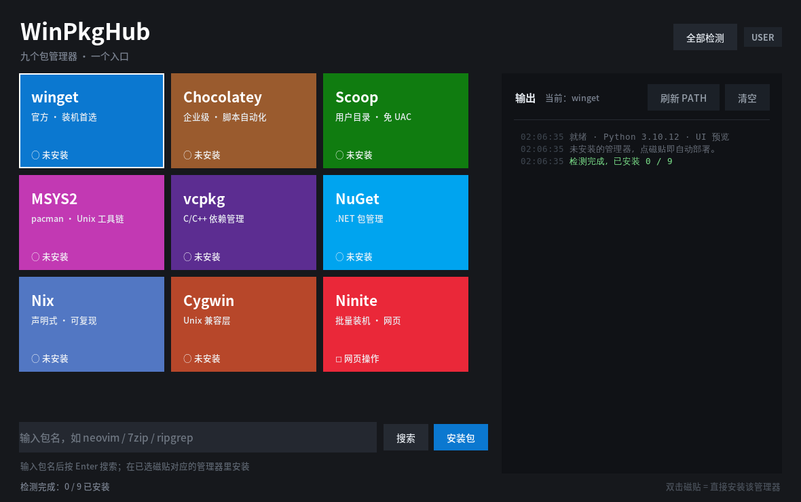

# WinPkgHub

Windows 8 磁贴风格的包管理器中枢：九个包管理器，一个窗口，随时切换调用；检测不到就当场自动部署。



> 截图是在 Linux 预览环境实跑的（仅界面，安装动作在非 Windows 会跳过）；Windows 上标题栏、字体为雅黑 + 等宽字体，磁贴布局一致。

## 运行

```bat
cd winpkghub
python main.py
```

要求：Windows 10/11 + Python 3.10+（只需标准库，Tkinter 自带）。双击 `run.bat` 也行。

## 九个磁贴分别做什么

| 磁贴 | 一键部署方式 | 权限 |
|---|---|---|
| **winget** | 没有则从 GitHub 拉官方 MSIX 包 `Add-AppxPackage` | 普通 |
| **Chocolatey** | 官方 install.ps1（`iex`） | **管理员（自动 UAC 提权）** |
| **Scoop** | `irm get.scoop.sh \| iex`，缺 git 时先装 Git.Git | 普通 |
| **MSYS2** | 下载官方安装器 → 静默装到 `%LOCALAPPDATA%\WinPkgHub\tools\msys64` | 普通 |
| **vcpkg** | `git clone` → `bootstrap-vcpkg.bat` | 普通 |
| **NuGet** | 下载 `nuget.exe` 到 `tools\nuget` | 普通 |
| **Nix** | Windows 无原生版，走 WSL2（界面直接给出三条命令） | — |
| **Cygwin** | `setup-x86_64.exe -q -O -s 清华镜像 -R tools\cygwin64` | 普通 |
| **Ninite** | 无 CLI，直接开网页勾选 | — |

## 操作路径

1. 点磁贴选中（白色描边即当前管理器），底部状态栏显示它的定位。
2. 双击磁贴 = 直接安装该管理器。
3. 输入框敲包名 → `搜索` 在当前管理器里查；`安装包` 直接装。若该管理器还没装，会先自动部署管理器，装完再点一次即可。
4. 装完自动 `刷新 PATH`（把 scoop shims、choco bin、msys2 usr\bin 等并入当前进程环境）。

## 各管理器的命令映射

```
winget  search <q>      /  install <q>
choco   search <q>      /  install <q> -y
scoop   search <q>      /  install <q>
msys2   bash -lc "pacman -Ss <q>"  /  pacman -S --noconfirm <q>
vcpkg   search <q>      /  install <q>
nuget   list <q>        /  install <q> -OutputDirectory tools\nuget\packages
nix     wsl bash -lc "nix search nixpkgs <q>" / nix profile install nixpkgs#<q>
cygwin  setup -q -P <pkg>
```

## 目录结构

```
winpkghub/
├── main.py        入口
├── ui.py          磁贴界面（Tkinter，无第三方依赖）
├── managers.py    九个管理器的探测/安装/搜索/装包
├── core.py        进程流式输出、UAC 提权、下载、PATH 刷新
├── run.bat        双击启动
├── build.bat      PyInstaller 打包成单文件 exe
└── preview/       设计预览图与渲染脚本
```

运行产物都在 `%LOCALAPPDATA%\WinPkgHub\`：`tools\` 放自动下载的东西，`logs\` 放提权脚本与 transcript。

## 打包成 exe

```bat
pip install pyinstaller
build.bat
```

生成 `dist\WinPkgHub.exe`，单文件、无控制台。若 `pyinstaller` 不在 PATH，`build.bat` 会自动回退到 `python -m PyInstaller`。

## 功能测试

```bat
python test_winpkghub.py
```

覆盖 45 项：进程执行/下载/GitHub 资产解析、九个管理器的命令映射、Tk 界面交互与事件泵，并含两条回归测试（scoop 的 .CMD shim 探测、提权结束标记的本地化兼容性）。

## 已修复问题

- **scoop 误报未安装**：scoop 在 Windows 上以 `scoop.CMD` shim 暴露，`CreateProcess` 用裸名 `scoop` 启动会失败（退出码 127）。`core.resolve_cmd()` 现在会把裸命令名解析为完整路径后再执行，探测/搜索/安装均正常。
- **UAC 提权任务检测依赖中文文案**：原先只认 `Windows PowerShell 脚本结束`，英文系统会空等 15 分钟。现改用自定义 `__WPH_DONE__` 标记，并兼容中英文结束文案；用户取消 UAC 时 20 秒内退出等待而非空转。

## 已知边界

- **Chocolatey 必须管理员**：程序会用 `Start-Process -Verb RunAs` 提权，输出通过 `Start-Transcript` 回传到右侧控制台。
- **Nix 在 Windows 不存在原生实现**，只能 WSL2；磁贴不会假装装成功，会打印那三条命令。
- **Ninite 无命令行**，只能开网页。
- **Cygwin 没有在线搜索接口**，安装包靠 `-P pkg1,pkg2` 指定。
- winget 的 MSIX 安装依赖 Windows App Runtime，LTSC 精简系统上可能失败，此时装 App Installer 即可。
- 界面在 Windows 上字体是 `Microsoft YaHei UI` + `Cascadia Mono/Consolas`；非 Windows 只能看界面，实际安装动作都会被跳过。
